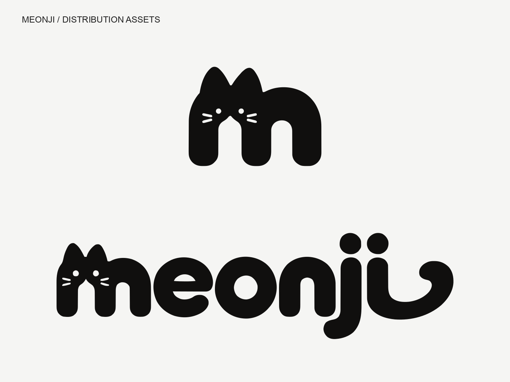

# MEONJI Brand Assets

기존에 완성된 SVG를 기준으로 제작한 배포 에셋입니다. 원본 디자인과 패스는 보존했습니다.

- [브랜드 사용 가이드](BRAND_GUIDELINES.md)
- [검증 결과와 한계](VALIDATION.md)
- [SVG 심볼](svg/symbol/) · [SVG 워드마크](svg/wordmark/)
- [PNG 심볼](png/symbol/) · [PNG 워드마크](png/wordmark/)
- [웹 에셋](web/) · [벡터 PDF](pdf/)
- [보존 원본](master/) · [전체 파일 명세](MANIFEST.json)

SVG·PNG·WebP는 원본 컬러, 검정, 흰색으로 제공합니다. PNG는 16~2048px의 8개 크기이며, 워드마크는 가로 폭 기준입니다. 심볼 64px 이상, 워드마크 가로 256px 이상을 권장합니다.

Favicon을 로컬에서 확인하려면 이 폴더를 정적 HTTP 서버로 연 후 `preview/browser-check.html`을 방문합니다. 실제 서비스 적용 시 `web/`의 경로에 맞게 `<link rel="icon">`을 설정합니다.

PDF는 벡터를 유지합니다. `logo-vector.pdf`는 심볼과 워드마크의 2페이지 합본입니다. 흰색 버전의 투명 구멍은 배경색을 그대로 보여줍니다.

## 제작 규격 (spec)

- [로고 제작 규격서](spec/CONSTRUCTION_GUIDE.md): 귀 각도, 기준 단위(1u), 비율, 여백, 제안 표준값
- [작도 이미지: 심볼](spec/construction-symbol.png) · [작도 이미지: 워드마크](spec/construction-wordmark.png)
- [측정 프로그램](spec/meonji-measure.html): 자·각도기로 직접 재보는 단일 HTML 파일 ([사용법](spec/MEASURE_README.md))
- 측정 스크립트와 데이터: [spec/tools](spec/tools/)
